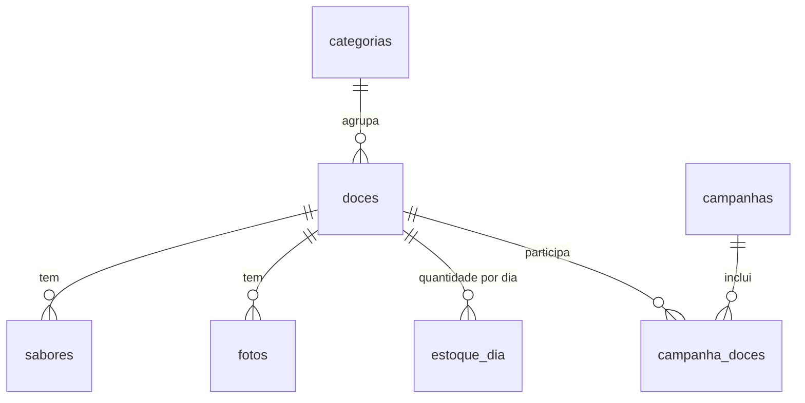

# Modelo de dados

O banco é MySQL (na hospedagem, MySQL 8.4; localmente também funciona com MariaDB 10.3 ou mais novo). O app cria e atualiza as tabelas sozinho: ninguém precisa rodar SQL na mão.

- Valores em dinheiro ficam em **centavos** (`900` = R$ 9,00), para não ter erro de arredondamento.
- Doces, categorias e campanhas usam um **id em texto** (ex.: `palha-italiana`), que também aparece no endereço da página (`/doce/palha-italiana`).
- Datas do dia (`DATE`) são do horário de Brasília. Horas gravadas pelo app (`atualizado_em`, `senha_provisoria_expira`) ficam em UTC.
- Texto em `utf8mb4` (acentos e emoji).

## Como o banco é criado e atualizado

Tudo acontece em `src/lib/banco.ts`, na **primeira vez que o app precisa do banco** depois de iniciar (a primeira visita depois de publicar ou reiniciar):

1. Roda [`banco/schema.sql`](../banco/schema.sql). Ele só tem `CREATE TABLE IF NOT EXISTS`, então só cria o que ainda não existe.
2. Se a tabela `categorias` estiver vazia (banco novo), carrega [`banco/dados-iniciais.sql`](../banco/dados-iniciais.sql).
3. Aplica, em ordem de nome, os arquivos de [`banco/migracoes/`](../banco/migracoes) que ainda não estão na tabela `migracoes`. Cada um roda **uma vez só** e fica registrado.

Se algum passo falhar (por exemplo, o usuário do banco sem permissão), o app tenta de novo na próxima visita. O endereço `/saude` mostra se a conexão e a preparação das tabelas deram certo ([publicar.md](publicar.md#7-conferir-e-diagnosticar)).

**Regra para mudar o banco:** o `schema.sql` descreve o banco **base** e não muda mais. Coluna ou tabela nova entra por um arquivo novo em `banco/migracoes/`, com o próximo número (`007-…sql`). Num banco novo, o app roda o schema, os dados iniciais e depois todas as migrações, então o resultado é sempre o mesmo. Prefira `CREATE TABLE IF NOT EXISTS`; um `ALTER TABLE` deve ser um comando só (se falhar, nada muda e a migração roda de novo no próximo início).

### Migrações

| Arquivo | O que faz |
| --- | --- |
| `001-tirar-doces-de-exemplo.sql` | Apaga os doces e as campanhas de exemplo do mockup que entraram na primeira publicação. Fica só a palha italiana |
| `002-recolocar-precos-dos-sabores.sql` | Recoloca o preço dos sabores Ninho (R$ 10) e Ninho com Nutella (R$ 11) da palha, que um erro antigo apagava ao salvar a ficha |
| `003-senha-individual.sql` | Senha de cada pessoa: colunas `senha_hash`, `trocar_senha`, `senha_provisoria_expira` e `sessao_versao` em `usuarios`, e a tabela `tentativas_login` |
| `004-dados-da-loja.sql` | Tabela `loja` (uma linha) com o WhatsApp, o horário de cada dia, retirada, entrega, pagamento e ingredientes da cozinha |
| `005-hora-do-estoque.sql` | Colunas `atualizado_em` e `atualizado_por` em `estoque_dia` ("Salvo hoje às 9:12 por Ana") |
| `006-alergenicos.sql` | Coluna `alergenicos` em `doces`, preenchida a partir de `contem_gluten` (trigo) e `contem_lactose` (leite) |

### Dados iniciais

Um banco novo recebe as 4 categorias (Brigadeiros, Palhas, Bolos de pote, Caixas e kits) e a **palha italiana**: R$ 9,00, sabores Tradicional (preço do doce), Ninho (R$ 10,00) e Ninho com Nutella (R$ 11,00), foto real (`/imagens/palha-italiana.jpg`), destaque e 12 unidades no dia.

O arquivo é gerado por `npm run banco:iniciais` (script `scripts/gerar-dados-iniciais-sql.ts`) a partir de `src/lib/dados-exemplo.ts`; não edite à mão. Os outros doces de `dados-exemplo.ts` servem só para o **modo demonstração** (app rodando sem banco).

## Diagrama

`usuarios`, `tentativas_login`, `loja` e `migracoes` não se ligam às outras tabelas.

## Tabelas

### categorias

| Coluna | Tipo | Observação |
| --- | --- | --- |
| id | `VARCHAR(40)`, chave | `brigadeiros`, `palhas`, `potes`, `kits` |
| nome | `VARCHAR(80)` | o que aparece nas abas da vitrine |
| ordem | `INT` | ordem das abas |

Ainda não há tela para criar categorias (ideia para depois).

### doces

| Coluna | Tipo | Observação |
| --- | --- | --- |
| id | `VARCHAR(80)`, chave | endereço da página: `/doce/<id>`. Criado a partir do nome ("Bolo de pote Ninho" → `bolo-de-pote-ninho`) |
| categoria_id | `VARCHAR(40)` | chave estrangeira para `categorias` |
| nome | `VARCHAR(120)` | |
| descricao | `TEXT` | |
| preco_centavos | `INT` | preço do doce (e dos sabores sem preço próprio). Nunca 0 |
| unidade | `VARCHAR(40)` | "por unidade", "por caixa", "por pote" |
| contem_gluten, contem_lactose | `TINYINT(1)` | colunas antigas. O app continua gravando (trigo e leite), mas lê `alergenicos` |
| alergenicos | `SET('leite','trigo','ovo','castanhas','amendoim','soja')`, pode ser NULL | o que o doce contém. Vazio = nenhum destes; NULL = não informado (a ficha pede para perguntar no WhatsApp). Migração 006 |
| composicao | `TEXT` | |
| conservacao | `TEXT` | |
| selo | `ENUM('nenhum','novo','mais_vendido')` | "Últimas unidades" não é gravado: sai da quantidade do dia |
| sob_encomenda | `TINYINT(1)` | 1 = feito quando alguém pede; não tem quantidade e nunca esgota |
| prazo_dias | `INT`, pode ser NULL | dias de preparo, só para sob encomenda |
| onde_aparece | `ENUM('ano_todo','so_campanhas')` | `so_campanhas` = só aparece enquanto uma campanha dele estiver no ar |
| destaque | `TINYINT(1)` | um doce em destaque por vez (a estrela do painel) |
| ativo | `TINYINT(1)` | 0 = fora da vitrine, sem apagar ("Na vitrine" desligado) |
| ordem | `INT` | ordem na vitrine |
| ilustracao | `VARCHAR(40)`, pode ser NULL | desenho provisório enquanto não há foto (ex.: `pote:morango`) |
| criado_em, atualizado_em | `TIMESTAMP` | |

### sabores

Sabores ou tamanhos de um doce ("Ninho", "350 ml").

| Coluna | Tipo | Observação |
| --- | --- | --- |
| id | `INT` automático | |
| doce_id | `VARCHAR(80)` | apaga junto com o doce |
| nome | `VARCHAR(80)` | a sacola guarda a escolha pelo **nome** |
| preco_centavos | `INT`, pode ser NULL | vazio = preço do doce. Com preços diferentes, a vitrine mostra "a partir de" |
| ordem | `INT` | |

Ao salvar a ficha, o app regrava os sabores com o nome e o preço que vieram do formulário (o id de cada sabor muda a cada "Salvar ficha"; por isso a sacola usa o nome).

### fotos

| Coluna | Tipo | Observação |
| --- | --- | --- |
| id | `INT` automático | |
| doce_id | `VARCHAR(80)` | apaga junto com o doce |
| caminho | `VARCHAR(255)` | nome do arquivo em `UPLOAD_DIR` (servido em `/fotos/<nome>`) ou caminho começando com `/` (ex.: `/imagens/palha-italiana.jpg`, que vem com o app) |
| ordem | `INT` | a de menor ordem é a principal |

As fotos enviadas pelo painel são reduzidas no próprio celular (até 1600 px, JPEG) e ficam numa pasta fora do app (`UPLOAD_DIR`), para não sumirem a cada publicação.

### estoque_dia

Uma linha por doce e por dia (o histórico fica). Vale a linha mais recente.

| Coluna | Tipo | Observação |
| --- | --- | --- |
| doce_id | `VARCHAR(80)` | chave junto com `data`; apaga junto com o doce |
| data | `DATE` | dia no horário de Brasília |
| quantidade | `INT` | 0 = esgotado |
| atualizado_em | `DATETIME` (UTC), pode ser NULL | quando foi salva. Migração 005 |
| atualizado_por | `VARCHAR(120)` | nome de quem salvou (vazio nas linhas antigas). Migração 005 |

Se a linha mais recente não é de hoje, a vitrine mostra "Pronta entrega · confirme no WhatsApp", sem número, e o painel mostra "Você ainda não salvou hoje".

### campanhas

| Coluna | Tipo | Observação |
| --- | --- | --- |
| id | `VARCHAR(80)`, chave | ex.: `natal-mone-2026` |
| tipo | `ENUM('natal','pascoa','dia_das_maes','dia_dos_namorados','dia_do_chocolate','dia_dos_pais','outra')` | |
| nome | `VARCHAR(120)` | "Natal Mone" |
| inicio, fim | `DATE` | período no ar |
| limite_encomenda | `DATE`, pode ser NULL | último dia para encomendar (entre o início e o fim) |
| frase_banner | `VARCHAR(255)` | o formulário limita a 60 letras |
| cor | `VARCHAR(9)` | cor do banner, em hexadecimal |
| pausada | `TINYINT(1)` | tirada do ar pela loja antes do fim |
| rascunho | `TINYINT(1)` | reservado: o app grava 0 (uma chave única "Ativa" fica para depois) |

"No ar" = hoje entre `inicio` e `fim`, sem `pausada` e sem `rascunho`.

### campanha_doces

Liga doces e campanhas (um doce pode estar em várias). As duas colunas formam a chave; apaga junto com o doce ou a campanha.

| Coluna | Tipo |
| --- | --- |
| campanha_id | `VARCHAR(80)` |
| doce_id | `VARCHAR(80)` |

### usuarios

Quem pode entrar no painel. Cada pessoa entra com o próprio e-mail e a própria senha.

| Coluna | Tipo | Observação |
| --- | --- | --- |
| id | `INT` automático | |
| email | `VARCHAR(190)`, único | qualquer e-mail; é o "usuário" para entrar |
| nome | `VARCHAR(120)` | aparece no painel, em Acessos e em "Salvo por" |
| foto | `VARCHAR(500)`, pode ser NULL | sobra do login com Google, não é mais usada |
| senha_hash | `VARCHAR(255)`, pode ser NULL | resumo scrypt com salt por pessoa (nunca a senha). Vazio = ainda não tem senha. Migração 003 |
| trocar_senha | `TINYINT(1)` | entrou com senha provisória ou com a chave de emergência e precisa criar a própria senha. Migração 003 |
| senha_provisoria_expira | `DATETIME` (UTC), pode ser NULL | validade da senha provisória (7 dias). Migração 003 |
| sessao_versao | `INT` | vai dentro do cookie da sessão. Aumentar derruba as sessões antigas da pessoa (trocar senha, gerar senha nova, sair de todos os aparelhos). Migração 003 |
| papel | `ENUM('admin','equipe','estoque')` | Administração, Equipe ou Estoque |
| ativo | `TINYINT(1)` | tirar o acesso grava 0 (o histórico fica) |
| tutorial_visto | `TINYINT(1)` | o guia "Como usar" não abre mais sozinho |
| criado_em | `TIMESTAMP` | |
| ultimo_acesso | `TIMESTAMP`, pode ser NULL | atualizado no máximo uma vez por dia |

Quem está em `ADMIN_EMAILS` (configuração do servidor) é a Administração fixa: não dá para remover nem mudar o papel em Acessos, e pode usar a chave de emergência (`PAINEL_SENHA`).

### tentativas_login

Senhas erradas, para o limite de tentativas (10 em 15 minutos do mesmo e-mail no mesmo IP, ou 30 do mesmo IP). Linhas com mais de 1 dia são apagadas sozinhas. Migração 003.

| Coluna | Tipo | Observação |
| --- | --- | --- |
| id | `INT` automático | |
| email | `VARCHAR(190)` | e-mail digitado |
| ip | `VARCHAR(64)` | IP de quem tentou |
| momento | `TIMESTAMP` | |

### loja

Uma linha só (`id = 1`), editada em **Painel › Dados da loja**. Criada pela migração 004 com os padrões. Sem banco, o app usa os mesmos padrões (`LOJA_PADRAO` em `src/lib/loja.ts`).

| Coluna | Tipo | Observação |
| --- | --- | --- |
| id | `TINYINT` | sempre 1 |
| whatsapp | `VARCHAR(13)` | 55 + DDD + número, só dígitos (padrão `5521980631673`). Vale para todos os botões de WhatsApp do app |
| horario_dom … horario_sab | `VARCHAR(11)` | `09:00-18:00`; vazio = fechado. Todos vazios = a vitrine não mostra horário nem "Aberto agora" |
| retirada, entrega, pagamento | `VARCHAR(80)` | textos que só informam; vazio = não aparece |
| tracos | `VARCHAR(100)` | ingredientes da cozinha separados por vírgula (leite, trigo, ovo, castanhas, amendoim, soja), para o "Pode conter traços de…". Com trigo, nenhum doce mostra "Sem glúten" |
| atualizado_em | `TIMESTAMP` | |

### migracoes

| Coluna | Tipo | Observação |
| --- | --- | --- |
| nome | `VARCHAR(190)`, chave | nome do arquivo de `banco/migracoes/` já aplicado |
| aplicada_em | `TIMESTAMP` | |

## Cache

As leituras de `src/lib/dados.ts` usam `'use cache'` com as marcas `cardapio` (doces, sabores, fotos, quantidades), `campanhas` e `loja`. Cada ação de salvar do painel chama `updateTag()` da marca certa, e a vitrine mostra a mudança na hora. Mudar o banco **por SQL, fora do app**, não limpa o cache: reinicie o app depois.

## O que fica só no celular

Nada de quem compra vai para o banco. No navegador (`localStorage`) ficam:

| Chave | O que guarda |
| --- | --- |
| `mone:favoritos` | doces favoritos |
| `mone:sacola` | a sacola (id do doce, nome do sabor, quantidade, preço e nome vistos na hora); some 7 dias depois da última mudança |
| `mone:nome` | o nome que a pessoa escreveu na sacola |
| `mone:ultimo-pedido` | o último pedido enviado (número, itens, total, mensagem); some 7 dias depois do envio |
| `mone:estoque:<id da pessoa>` | no painel: quantidades mexidas e não salvas em O que tem hoje (some ao salvar e ao sair do painel) |
| `mone:tutorial-visto` | só no modo demonstração: o guia "Como usar" já foi visto |

Enviar a mensagem no WhatsApp é fazer o pedido. Se um dia a loja quiser uma lista de pedidos no painel, entram as tabelas `pedidos` e `itens_pedido`; ao guardar dados de quem compra, revisar a LGPD ([proximos-passos.md](proximos-passos.md)).
