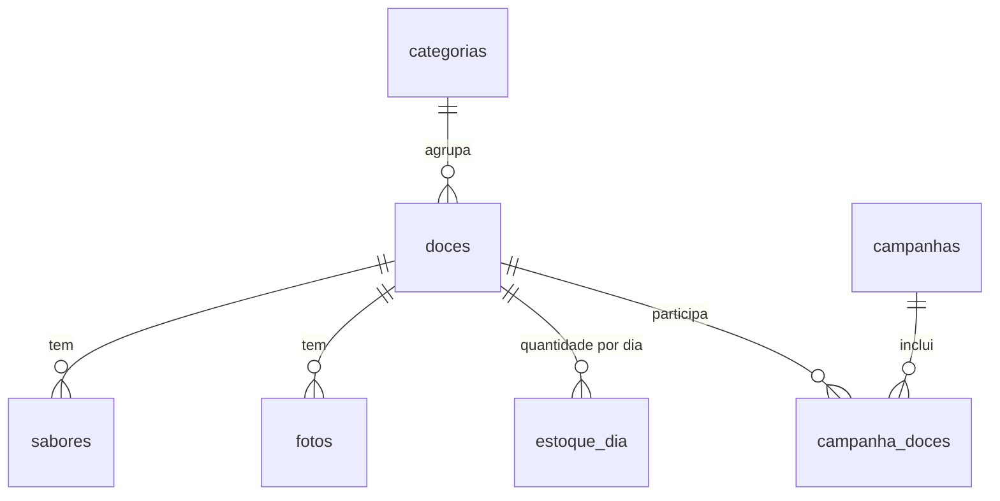

# Modelo de dados (proposta)

Ponto de partida para o banco, tirado das telas do mockup. A versão pronta para rodar no MySQL está em [`banco/schema.sql`](../banco/schema.sql); o app cria as tabelas sozinho num banco vazio. Valores em dinheiro ficam em centavos para evitar erro de arredondamento. Doces, categorias e campanhas usam um id em texto (ex.: `palha-italiana`), que também aparece no endereço da página.

## Tabelas

### categorias

| Coluna | Tipo | Observação |
| --- | --- | --- |
| id | texto | |
| nome | texto | Brigadeiros, Palhas, Bolos de pote, Caixas e kits |
| ordem | inteiro | ordem dos chips na vitrine |

### doces

| Coluna | Tipo | Observação |
| --- | --- | --- |
| id | texto | endereço da página: `/doce/<id>` |
| categoria_id | texto | |
| nome | texto | |
| descricao | texto | |
| preco_centavos | inteiro | |
| unidade | texto | "por unidade", "por caixa" |
| contem_gluten | booleano | |
| contem_lactose | booleano | |
| composicao | texto | |
| conservacao | texto | |
| selo | enum | nenhum, novo, mais_vendido. "Últimas unidades" é calculado pelo estoque |
| sob_encomenda | booleano | se verdadeiro, ignora estoque |
| prazo_dias | inteiro | só para sob encomenda |
| onde_aparece | enum | ano_todo, so_campanhas |
| destaque | booleano | só um doce em destaque por vez |
| ativo | booleano | esconder sem apagar |
| ordem | inteiro | ordem na vitrine |
| ilustracao | texto, opcional | desenho provisório (ex.: `pote:morango`) enquanto não há foto |
| criado_em, atualizado_em | data e hora | |

### sabores

| Coluna | Tipo | Observação |
| --- | --- | --- |
| id | inteiro (automático) | |
| doce_id | texto | |
| nome | texto | Tradicional, Ninho... |
| preco_centavos | inteiro, opcional | vazio = mesmo preço do doce |
| ordem | inteiro | |

### fotos

| Coluna | Tipo | Observação |
| --- | --- | --- |
| id | inteiro (automático) | |
| doce_id | texto | |
| caminho | texto | arquivo em `UPLOAD_DIR` (servido em `/fotos/<nome>`) |
| ordem | inteiro | a de menor ordem é a principal |

### estoque_dia

Uma linha por doce e por dia guarda o histórico do que foi produzido. Vale a linha mais recente: se a dona não atualizar num dia, continua valendo a quantidade do último dia salvo.

| Coluna | Tipo | Observação |
| --- | --- | --- |
| doce_id | texto | chave junto com `data` |
| data | data | |
| quantidade | inteiro | 0 = esgotado |

### campanhas

| Coluna | Tipo | Observação |
| --- | --- | --- |
| id | texto | |
| tipo | enum | natal, pascoa, dia_das_maes, dia_dos_namorados, dia_do_chocolate, dia_dos_pais, outra |
| nome | texto | "Natal Mone" |
| inicio, fim | data | período no ar |
| limite_encomenda | data, opcional | último dia para encomendar |
| frase_banner | texto | |
| cor | texto | hexadecimal |
| pausada | booleano | "no ar" = hoje entre início e fim e não pausada |
| rascunho | booleano | |

### campanha_doces

Liga doces e campanhas (um doce pode estar em várias campanhas).

| Coluna | Tipo |
| --- | --- |
| campanha_id | texto |
| doce_id | texto |

## Consultas principais

- **Vitrine de hoje:** doces ativos com `onde_aparece = ano_todo`, mais os doces `so_campanhas` que estão em alguma campanha no ar. Junta o `estoque_dia` de hoje.
- **Doces da campanha:** `campanha_doces` da campanha no ar.

## Fase 2

Tabelas `pedidos` e `itens_pedido` quando a encomenda passar a ser feita dentro do app. Ao guardar dados de clientes, revisar a LGPD.
